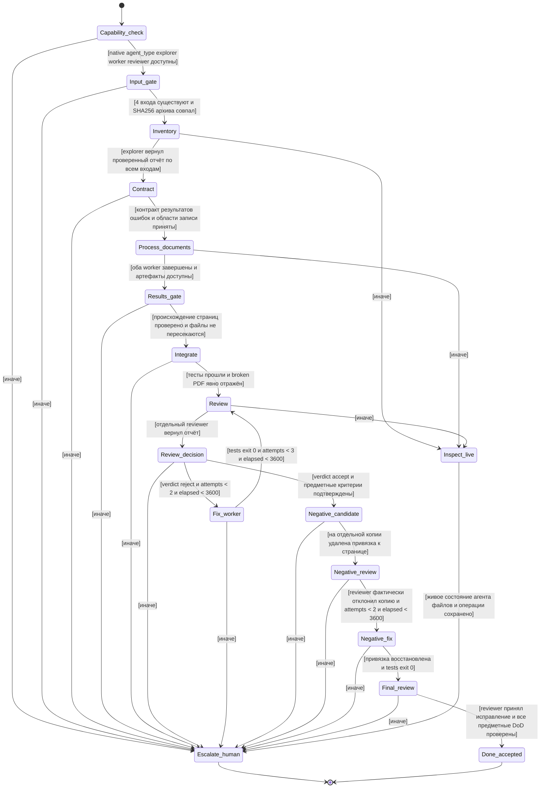
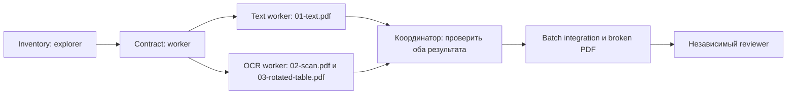

# SA11 — граф реального выполнения

Версия подготовлена **до предметной реализации SA11**. Основная сессия — координатор. Нельзя выдавать H04 либо агентов, которым только дали имя роли, за выполнение SA11.

## Пределы

- N = 2 исправления на весь запуск, общий счётчик `attempts` увеличивается перед Fix_worker или Negative_fix, не сбрасывается.
- T = 3600 секунд от начала запуска, сохраняется `started_at` с часовым пояссом; все возвраты используют исходный срок.
- Максимум 3 открытых нативных субагента, максимум 2 параллельных пишущих worker. Reviewer запускается отдельно после принятия результатов; исполнители не делегируют.
- Единственная петля Review_decision → Fix_worker → Review и исправление отрицательного сценария используют общий N/T. При исчерпании — Escalate_human.
- Ошибка/таймаут/неизвестный исход не разрешают повтор вслепую: Inspect_live проверяет агента, файлы и идентификатор операции. В этом запуске после проверки выполняется остановка, автоматического повторного dispatch нет.

## Владельцы и наблюдения

| Состояние | Владелец / тип | Вход, действие и доказательство |
|---|---|---|
| Capability_check | координатор | Проверить именно параметр `agent_type` и доступность ролей в текущем runtime. TOML на диске не доказывает загрузку. |
| Input_gate | координатор | Четыре PDF из kit/H04/input и SHA-256 в evidence/provenance.json. Повреждённый четвёртый PDF является ожидаемым предметным случаем. |
| Inventory | explorer, только чтение | Инвентаризация страниц, текстового слоя, растровых/повёрнутых страниц и непригодного PDF; координатор сохраняет ответ с agent ID в inventory.md. |
| Contract | worker | Формат записи: source, page (1-based), method, text/tables, uncertainty; формат ошибки: source, error, continued. Корректные результаты и ошибка не смешиваются. |
| Process_documents | два worker, разные worktree | Текстовая ветвь и OCR-ветвь ниже. Каждый возвращает файлы, команды, exit codes и ограничения. До первого raw checks не читается. |
| Results_gate | координатор | Проверка реального diff, тестов, наличия всех страниц, provenance и непересекающихся файлов. Самоотчёт не заменяет проверку. |
| Integrate | координатор | Один владелец batch CLI, сводного отчёта и README. Ошибка 04-broken.pdf не останавливает остальные документы. |
| Review / Final_review | reviewer, только чтение | Отдельный независимый агент проверяет diff, источники, страницы, числа, тесты и предметные DoD; координатор сохраняет дословные выводы без приватной истории. |
| Fix_worker / Negative_fix | worker | Ограниченное исправление, общий счётчик увеличен до dispatch, regression RED/GREEN для кода. |
| Negative_candidate | координатор | Создать копию результатов в evidence/negative/, удалить один page, не портить принятый основной результат. |
| Negative_review | reviewer, только чтение | Настоящий отрицательный вывод по отсутствующей странице; проверка должна выявить дефект, а не принять поддельный результат. |
| Inspect_live | координатор | Сверить agent/run ID, состояние процесса и файлы, сохранить неизвестный исход. Нового исполнителя не запускать. |
| Done_accepted | координатор | Только локальная приёмка после фактического успешного и отрицательного прогона. Одобрение преподавателя и merge — отдельные действия человека. |
| Escalate_human | координатор | Завершение текущего запуска с точным блокером; продолжение после его устранения — новый явно обозначенный запуск. |

## Параллельные ветви и порядок сведения

Text worker пишет только `src/text_extract.py`, `tests/test_text_extract.py`, `result/text/`, `evidence/text/`. OCR worker — только `src/ocr_extract.*`, `tests/test_ocr_extract.*`, `result/ocr/`, `evidence/ocr/` и свои зависимости. Они используют разные worktree и ветки `student/EnterFC/SA11-text` и `student/EnterFC/SA11-ocr`. Координатор один пишет `run_batch.py`, общий `report.md`, `README.md`, `run-log.md`, `evidence/negative/` и результаты интеграции в `student/EnterFC/SA11`.

Оба результата должны существовать и пройти проверки до сведения. Изменения принимаются координатором по конкретным файлам/коммитам; вне `submissions/EnterFC/SA11/` запись запрещена. Субагенты не делают push, merge и внешних публикаций.

## Проверка графа

Скрипт agent-behavior-graph проверяет плоскую stateDiagram-v2 и пропускает дополнительный flowchart. Он не доказывает фактическую доступность ролей, изменение счётчика и истинность предметных проверок. Эти факты требуют журнала запусков и независимого ревью. Результат структурной проверки и визуального рендера хранится в evidence.
