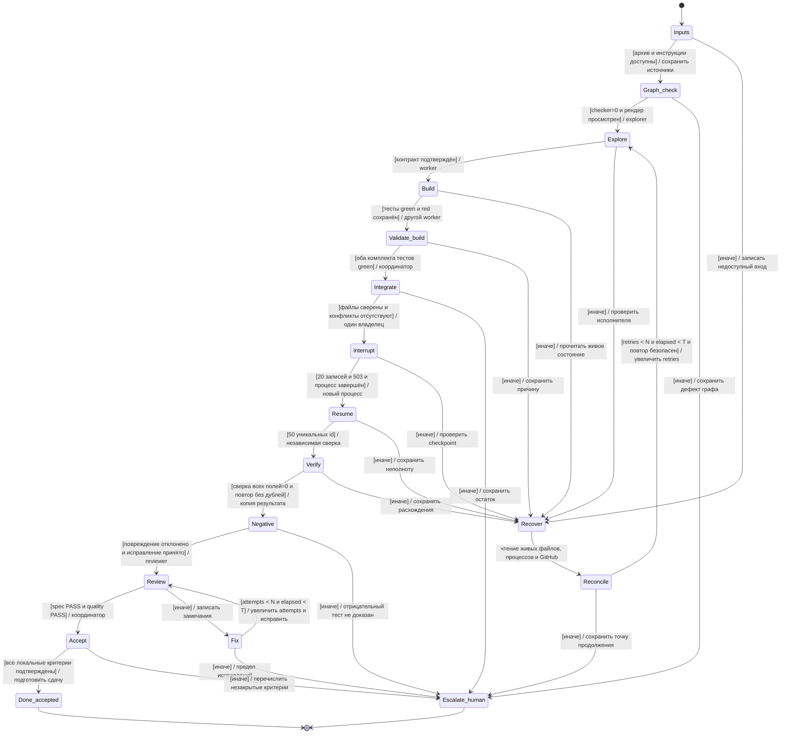
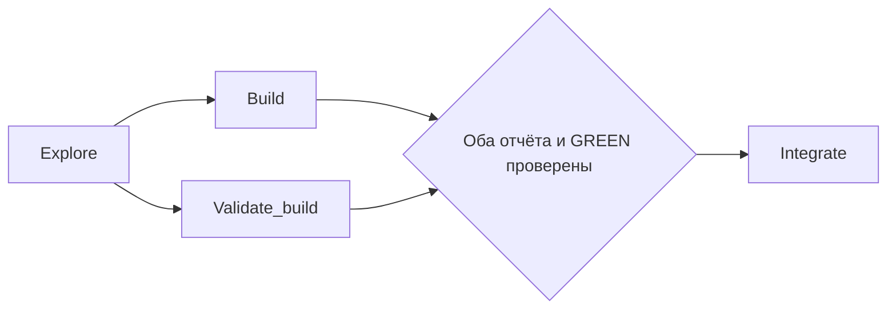

# SA12: граф выполнения

Создан до реализации и предметных запусков. Координатор — основная сессия Codex.
Вход: issue #74, уточнения #49, закреплённый H13.zip с проверенной SHA-256.
Цель: 50 товаров через DOM браузера, управляемый 503 после 20 записей,
новый процесс продолжения, независимая сверка и один PR без merge.

## Владельцы, артефакты и зависимости

| Состояние | Владелец / тип | Вход, действие и наблюдаемый выход |
|---|---|---|
| Inputs, Graph_check | координатор | SHA-256 архива, снимки issue, checker и изображение графа |
| Explore | `explorer` | Только чтение стенда и постановки; контракт DOM/полей/сбоя в отчёте, без правок |
| Build | `worker` collector | collector.py, tests/test_collector.py, evidence/collector-tests.txt; отдельный SA12-worker worktree |
| Validate_build | другой `worker` validator | validate.py, tests/test_validate.py, evidence/validator-tests.txt; отдельный SA12-validator worktree |
| Integrate | координатор | Реальные diff, тесты, копирование только разрешённых файлов |
| Interrupt, Resume | координатор запускает код worker | Один checkpoint; отдельные PID двух запусков, 20 товаров+503, затем 50 |
| Verify, Negative | координатор запускает независимый validator | Проверка всех полей после первого результата, отклонение удалённой записи, восстановление и повтор |
| Review | отдельный `reviewer` | Только чтение интеграции и evidence, два вердикта и замечания |
| Fix | первоначальный `worker` | Только принадлежащие ему файлы, повтор затронутых проверок |
| Recover, Reconcile | координатор | Неизвестный исход: сначала status/PID/checkpoint или чтение GitHub, без слепого повтора |
| Accept | координатор | Сверка каждого DoD, README и единый PR |

Разрешена параллельная аналитическая ветвь Explore с проектированием проверки полноты,
если общий контракт уже известен; объединение только при наличии обоих проверенных отчётов.
В этом запуске выбран последовательный порядок Build → Validate_build: он исключает
двух пишущих владельцев одного состояния и упрощает интеграцию. Параллельность —
разрешённая возможность, не требование запуска. Запрещены параллельные сборщики.

Диаграмма зависимостей показывает две независимые ветви кода после контракта.
Их можно выполнять параллельно только в указанных разных worktree; фактический
запуск выбран последовательным и отмечается в run-log. Условие объединения —
оба отчёта, реальные файлы и оба набора GREEN, а не только завершение агентов.

## Пределы

Решение координатора до исполнения: N=2 исправления/повтора, T=120 минут от первой
записи run-log, максимум 3 субагента одновременно. Каждый агент получает до 20 минут
в пределах исходного T. Общий deadline и счётчики сохраняются при восстановлении.
Петля Review → Fix → Review увеличивает attempts перед каждым исправлением.
Петля Recover → Reconcile → Explore увеличивает retries перед повтором и не сбрасывает
attempts/T; уже завершённые этапы сверяются и пропускаются по живым артефактам.
При неизвестном исходе создания issue/PR сначала GET/search, при зависшем агенте —
list_agents и проверка файлов. Недоступный обязательный вход ведёт через Recover
к Escalate_human, если безопасный повтор не восстановил его в пределах N/T.
Escalate_human завершает текущий запуск и оставляет данные, журнал и точку продолжения.

Done_accepted — локальная приёмка координатором. Merge и приёмка преподавателем
остаются отдельными действиями человека. Структурный checker — эвристика, он не
доказывает изменение счётчиков, семантику условий, реальность агентов или выполнения.
