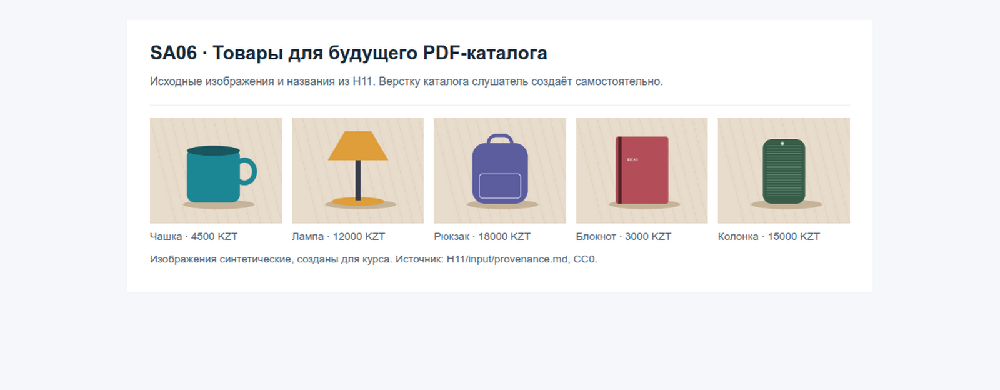

[SA06] Собрать товарный каталог магазина «Точка идеи»

## Outcome

Собери трёхстраничный PDF-каталог магазина «Точка идеи» по пяти товарам из CSV и готовым изображениям. Сверь каждую карточку и передай редактируемую сборку.

**Исполнитель:** @Vrnur. **Код:** SA06. **Тема:** день 2 курса, декомпозиция и выполнение по графу с нативными субагентами Codex.

Дополнительный результат этого упражнения — самостоятельно превратить постановку в GitHub-веху с подзадачами и выполнить её по проверяемому графу, используя несколько типов субагентов.

<!-- course-task-illustration:SA06:v1 -->
## Как выглядит объект задания

Товары из исходного комплекта: изображения, названия и цены. Из них предстоит сверстать PDF-каталог; показана галерея входных материалов, а не готовый макет каталога.

*Источник: учебный комплект; [происхождение и права на изображения](https://github.com/ARepnikov777/Training/blob/b4aaafa248f4d159e492a470ddb26bf0fbd1ae7d/assets/task-illustrations/README.md). Иллюстрация поясняет исходные материалы и не заменяет условия и критерии ниже.*

<!-- /course-task-illustration:SA06:v1 -->

## Ситуация и заказчик

Небольшой магазин подарков и офисных аксессуаров **«Точка идеи»** готовит PDF для отправки корпоративным покупателям перед сезонными закупками. Менеджер уже передал таблицу и пять предметных иллюстраций. Заказчик не просит придумывать ассортимент: ему нужен аккуратный каталог, где цена и изображение не перепутаны. В рамках упражнения отправлять каталог кому-либо не нужно.

Ассортимент из `input/products.csv`: **чашка — 4500 KZT**, **настольная лампа — 12000 KZT**, **рюкзак — 18000 KZT**, **блокнот — 3000 KZT**, **портативная колонка — 15000 KZT**. Названия, описания и имена изображений переноси из CSV без рекламных дополнений. Иллюстрации синтетические и не подтверждают свойства реальных товаров.

Формат уже выбран заказчиком: **A4, три страницы, по две карточки на первых двух страницах и одна на последней**. Светлый фон, предметы целиком, читаемые цены в KZT. Не добавляй вымышленные скидки, гарантию, технические характеристики, контакты и наличие на складе.

Все организации, люди, товары и события в этом кейсе вымышленные. Добавленное описание задаёт рабочую ситуацию и получателя результата; факты первичных документов, входные значения, контрольные примеры и ограничения из выданного комплекта сохраняются.

## Что передать заказчику

Передай **трёхстраничный PDF**, редактируемый макет или сценарий сборки и ведомость сверки: `id товара, строка CSV, файл изображения, страница PDF, результат проверки`. Сохрани происхождение использованных изображений и шрифтов.

**Сценарий использования:** менеджер открывает PDF на ноутбуке и печатает A4. По любой карточке можно однозначно найти строку CSV и исходное изображение. Все пять товаров показаны ровно один раз, подписи не обрезаны, изображение соседнего товара не попало в карточку. Reviewer проверяет каждую страницу визуально и каждую карточку предметно.

## Входные материалы и границы

- Предметная основа: [исходное задание H11 — Собрать локальный PDF-каталог товаров](https://github.com/ARepnikov777/Training/issues/47).
- [Скачать готовый комплект H11.zip](https://raw.githubusercontent.com/ARepnikov777/Training/22aad84cc6666d2b0abca011e95a96b12e69c9cd/downloads/H11.zip). Прочитай README, input и уточнения исходного issue. Точные правила и контрольные данные не придумывай.
- Условия исходного задания о необязательности нескольких агентов относятся к исходному упражнению. В **SA06** действуют дополнительные требования ниже: реальные субагенты, граф, независимое ревью. Предметные требования исходного кейса сохраняются.
- Это отдельное упражнение: старое issue не переназначай, не закрывай автоматически и его решение не перезаписывай. Если оно уже выполнено, можешь использовать свою копию результата как стартовую, явно указав это; выполнение по графу и независимая проверка должны быть новыми и зафиксированными.
- Все данные синтетические. Работа локальная, без production, SSH, платных API и рассылок. Дополнительных материалов от преподавателя не требуется.

## Предметные критерии результата

- Все товары представлены в PDF ровно по одному разу с верными изображением, названием, описанием и ценой.
- Каталог имеет единый стиль, читаемые подписи; нет обрезанного текста, наложений и потерянных изображений.
- Проверена каждая страница и соответствие каждой карточки исходной строке CSV.
- Переданы PDF, редактируемый исходник/сценарий сборки и список использованных материалов с происхождением.

## Задание слушателю: подготовить веху

Создай в этом репозитории отдельную GitHub Milestone с кодом **SA06** и своим логином, назначь ей это issue и созданные тобой подзадачи. В описание вехи внеси итоговый результат и критерии его приёмки. Подзадачи свяжи с этим issue нативной связью sub-issues; одной таблицы ссылок недостаточно. Везде сохрани метку `subagents` и свой assignee.

Декомпозицию выполни сам с агентом. Ориентир — 4–7 ограниченных подзадач, число обоснуй. Для каждой задай входы, выходной артефакт, разрешённые файлы, запреты, зависимости, роль, проверяемый DoD и ветку/worktree. Не дроби работу на декоративные задачи и не поручай разным исполнителям править один общий файл.

**Подсказка по зависимостям, не готовая декомпозиция:** CSV и изображения → проверенные карточки → сборка PDF → независимая сверка страниц.

**Возможность параллельности:** Проверку товарных данных и подготовку изображений можно разделить по разным артефактам. Вёрстка общего PDF выполняется после согласования схемы карточки. Докажи независимость по входам/выходам. Общие интерфейсы утверди до параллельной реализации. Если параллельная запись не оправдана, обоснуй это и распараллель независимые исследования или проверки.

## Граф выполнения

Подготовь `workflow.md` с Mermaid `stateDiagram-v2` и пояснениями узлов. Граф должен управлять реальным выполнением, а не описывать его задним числом.

- Для каждого рабочего состояния укажи владельца и конкретный тип субагента. Используй **минимум три разных типа**: `explorer`, `worker`, `reviewer`. Основная сессия — координатор. `docs_researcher` добавляй для отдельной проверки API/документации, когда она нужна. Самопроверка worker не считается независимым reviewer.
- Покажи зависимости, разрешённые параллельные ветви и условие их объединения. Координатор проверяет все обязательные результаты до интеграции.
- Переходы зависят от наблюдаемых фактов: кода проверки, наличия артефакта, конкретного вывода reviewer. У каждой развилки — одно ребро `[иначе]`.
- Покажи возврат на исправление после замечания reviewer и предел на ребре нового круга. **До запуска** выбери и запиши N попыток исправления, T общего ожидания и предел параллелизма. В разделе «Пределы» укажи каждую петлю; повторы не обнуляют исходный срок и счётчики.
- Предусмотри недоступный вход, ошибку исполнителя/таймаут и неизвестный исход операции: сначала проверка живого состояния, затем обоснованный повтор либо остановка. Обязательные финалы: `Done_accepted` и `Escalate_human`; эскалация завершает текущий запуск, а не запускает бесконечный повтор.
- `Done_accepted` означает локальную приёмку координатором по предметным критериям. Приёмка преподавателем и merge PR остаются отдельным действием человека.

**Характерная проверка для этого кейса:** изображение не соответствует товару либо на странице обрезана обязательная подпись. Выбери безопасный отрицательный сценарий на копии материалов, который действительно проверит соответствующую развилку графа. Не утверждай, что ветка пройдена, если её только нарисовал.

## Work mode и выполнение

**Сейчас преподаватель выдаёт только исходную задачу.** Веху, подзадачи, граф и запуск создаёшь ты на практике. Не выдавай создание схемы за выполнение кейса.

- После подготовки и проверки графа запусти реальные нативные субагенты в Codex с входом ChatGPT. Настройка: [готовый промпт](https://github.com/mbk-dev/ai-learning/blob/main/docs/codex-native-subagents-setup-prompt.md). API-ключи, OpenCode и OpenRouter не нужны.
- Рабочий каталог каждого исполнителя — его явный checkout/worktree репозитория `ARepnikov777/Training`; область записи только `submissions/Vrnur/SA06/`. Интеграционная ветка — `student/Vrnur/SA06`. Рабочие ветки — `student/Vrnur/SA06-ИМЯ`. Параллельным пишущим агентам — разные worktree и разные выходные файлы. Не меняй `materials/`, `downloads/`, общие инструменты и результаты других слушателей.
- Исполнитель делает ограниченную работу и возвращает ссылки на файлы и проверки. Координатор самостоятельно сверяет их, интегрирует результат и передаёт его отдельному reviewer. Субагенты не переделегируют работу, не делают push, merge и внешнюю публикацию самостоятельно.
- Сохраняй прогресс в `submissions/Vrnur/SA06/run-log.md`: время, run/agent ID (если доступен), тип субагента, состояние, наблюдаемый результат, выбранный переход, попытка, артефакт и проверка. Не публикуй секреты и полные приватные истории чата. Лог без доступных идентификаторов дополни свидетельством реальных запусков из интерфейса/отчёта Codex.
- Сохрани отдельные брифы и отчёт reviewer. Покажи хотя бы один успешный сквозной прогон и один контролируемый отрицательный сценарий с исправлением или корректной эскалацией. Для кода сохраняй релевантные тесты до/после исправления, для документов и графики — предметную и визуальную проверку.
- Модели выбирай из доступных в аккаунте. Недоступную роль/модель зафиксируй и настрой до запуска; самовольная имитация нескольких ролей одной сессией не засчитывается. Повторную настройку среды не превращай в предметную реализацию.

## Definition of Done (DoD)

- [ ] Предметный результат удовлетворяет **всем** предметным критериям и формату раздела «Что передать заказчику»; в README для каждого есть отдельное доказательство, исходные материалы сохранены.
- [ ] Создана персональная GitHub-веха с результатом и критериями приёмки; это issue и нативно связанные подзадачи включены в неё, зависимости/владельцы/области записи определены и доступны по ссылкам.
- [ ] До реализации сохранён и проверен граф с минимум тремя типами субагентов, обоснованной параллельностью, наблюдаемыми условиями, ограниченными повторами, локальной приёмкой и эскалацией. Mermaid отрендерен и просмотрен; структурная проверка записана с её ограничениями.
- [ ] Журнал и артефакты подтверждают реальные запуски `explorer`, `worker`, отдельного `reviewer`, успешную интеграцию и выбранный отрицательный сценарий; замечания reviewer исправлены либо явно оставлены как блокеры, локальный успех не объявлен при невыполненных критериях.
- [ ] В одном PR в `main` переданы результат, исходники, `workflow.md`, брифы, `run-log.md`, отчёт reviewer и README с командами/порядком повторения. Ссылки на веху, подзадачи и PR добавлены в это issue; объединение PR оставлено преподавателю.

## Сдача и источники

Следуй [правилам сдачи репозитория](https://github.com/ARepnikov777/Training#подготовка-и-сдача-задания), используя код `SA06` вместо E01. В PR укажи номер этого issue в строке «Задание: …», без `Closes`; один PR на весь этот кейс, промежуточные ветки не публикуй без необходимости. Шаблон PR дополни кодом `SA06` и ссылками на граф/веху.

Граф и критерии: [учебный agent-behavior-graph](https://github.com/mbk-dev/ai-learning/blob/main/skills/agent-behavior-graph/SKILL.md), [проверяющий скрипт](https://github.com/mbk-dev/ai-learning/blob/main/skills/agent-behavior-graph/scripts/graph_check.py), [учебный AGENTS.md](https://github.com/mbk-dev/ai-learning/blob/main/AGENTS.md). Проверяющий скрипт — эвристика; он не доказывает фактическое выполнение графа.

<!-- course-subagents:SA06:Vrnur -->
