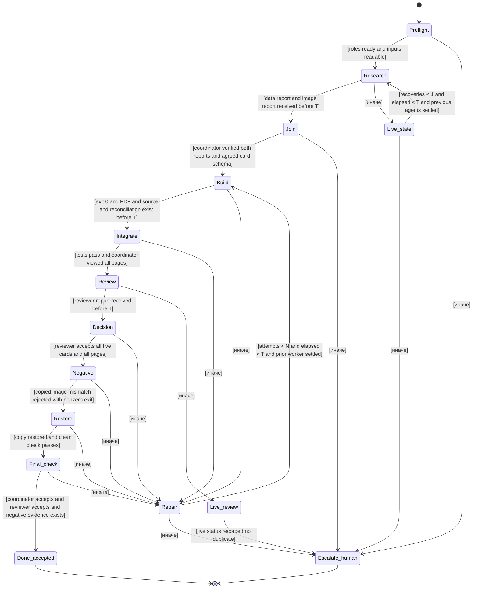

# SA06: граф исполнения

Подготовлен координатором до предметных запусков 2026-11-15. Задача #57, H11 #47. Цель: локальная приёмка каталога A4 3 страницы 2+2+1, точные пять строк CSV, редактируемая сборка и сверка. GitHub и merge не являются предметной приёмкой.

## Пределы

N = 3 суммарных попытки исправления. T = 120 минут от первого предметного запуска, без сброса при восстановлении. Параллелизм не более 3 нативных субагентов. Только один пишущий worker в этом worktree, координатор не пишет предметную реализацию. Предварительные проверки готовности ролей не являются предметным исполнением.

Петли: Repair → Build допускается только при attempts < N и elapsed < T, attempts увеличивается перед передачей исправлений worker. Live_state → Research допускается только при recoveries < 1 и elapsed < T, recoveries увеличивается до повторного исследования. Никаких автоматических повторов внешней записи: сначала GET ресурса, сверка ID/ветки/PR, затем решение человека либо продолжение уже выполненного шага. Ожидание субагента ограничено остатком T. Таймаут не доказывает завершение: сначала проверить живое состояние, не запускать дубль.

## Владельцы, входы, выходы и наблюдения

| Состояние | Владелец и тип | Вход и проверяемый результат |
|---|---|---|
| Preflight | координатор + readiness worker/reviewer | SHA256 ZIP, реальные ответы типов, граф проверен и просмотрен до Research |
| Research | два explorer, только чтение | параллельно: CSV/правила → отчёт данных; PNG/лицензии → отчёт изображений. Общих записей нет |
| Join | координатор | прочитать исходники и оба отчёта; контракт карточки: id,csv_line,name,description,price_KZT,image,page,sha256 |
| Build | worker | утверждённые входы → сценарий, PDF, сверка, тесты и Red/Green; запись только в область задания |
| Integrate | координатор | diff, сборка, тесты, A4/3/2+2+1, визуально три страницы, каждая карточка |
| Review | reviewer без записи | независимая проверка кода и PDF/рендеров каждой страницы, отчёт в ответе; координатор сохраняет дословно |
| Decision | координатор | явное решение reviewer и отсутствие блокеров |
| Negative | координатор запускает сценарий worker, reviewer сверяет | копия материалов: подмена PNG P01 изображением P02; проверка обязана отклонить; исходные входы не изменяются |
| Restore | координатор | восстановить копию и повторить проверку; чистый PDF не подменять отрицательным |
| Repair | worker | конкретные подтверждённые замечания, attempts + 1; затем новая интеграция и reviewer |
| Live_state, Live_review | координатор | проверить статус/ID/файлы, сохранить результат, неизвестный исход не считать неуспехом или успехом |
| Final_check | координатор | весь DoD и свидетельства переходов |
| Done_accepted | координатор | только локальная приёмка, преподаватель принимает и объединяет отдельно |
| Escalate_human | координатор | завершить запуск, назвать блокер, сохранить артефакты и незавершённые операции |

Research — плоское обозначение двух независимых read-only ветвей, обе обязательны. Их входы: CSV/brief против PNG/LICENSE/provenance; выходы: отдельные отчёты, объединение только после обоих. Параллельная предметная запись не оправдана: общий PDF имеет единый макет, поэтому worker один. Проверяющий скрипт поддерживает плоскую схему, не доказывает параллельность и фактические переходы.

## Проверка до запуска

`python3 tools/graph_check.py workflow.md`; отдельно Mermaid render и просмотр изображения. Ручная проверка: все состояния достижимы и имеют путь в финал; у каждой развилки ровно один fallback; лимиты счётчиков заданы выше; Escalate не продолжает запуск. Источники: учебный agent-behavior-graph/SKILL.md и graph_check.py из mbk-dev/ai-learning, загружены 2026-11-15, скрипт сохранён без изменений. Фактически пройденные ветви — только по run-log.md.
