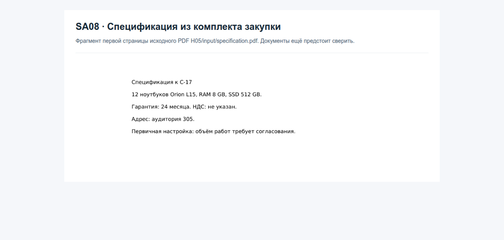

## Outcome

Подготовь для директора учебного центра «Вектор» сверку договора C-17, приложения и спецификации на ноутбуки Orion L15. Отдели доказанные расхождения от вопросов, требующих согласования с мастерской «Орион».

**Исполнитель:** @YK-cloud-hub. **Код:** SA08. **Тема:** день 2 курса, декомпозиция и выполнение по графу с нативными субагентами Codex.

Дополнительный результат этого упражнения — самостоятельно превратить постановку в GitHub-веху с подзадачами и выполнить её по проверяемому графу, используя несколько типов субагентов.

<!-- course-task-illustration:SA08:v1 -->
## Как выглядит объект задания

Фрагмент спецификации к закупке ноутбуков из исходного PDF. Это один документ комплекта: договор, приложение и спецификацию ещё предстоит сопоставить.

*Источник: учебный комплект; [происхождение и права на изображения](https://github.com/ARepnikov777/Training/blob/b4aaafa248f4d159e492a470ddb26bf0fbd1ae7d/assets/task-illustrations/README.md). Иллюстрация поясняет исходные материалы и не заменяет условия и критерии ниже.*

<!-- /course-task-illustration:SA08:v1 -->

## Ситуация и заказчик

**Учебный центр «Вектор»** готовит компьютерный класс и согласует поставку с **мастерской «Орион»**. Менеджер получил договор **C-17**, приложение №1 и техническую спецификацию, подготовленные разными участниками сделки. Перед согласованием директор просит проверить, описывают ли они одну и ту же закупку и какие вопросы надо вернуть поставщику.

В договоре названы ноутбуки **Orion L15**, аудитория **305**, цена единицы и условия поставки. Сопоставлению подлежат количество, конфигурация памяти/накопителя, стоимость, дата, гарантия, НДС и первичная настройка. Конкретные значения извлекай из трёх PDF; в рассказе намеренно не перечислены расхождения. Ни одному документу нельзя самовольно назначить приоритет, если порядок приоритета не задан.

Заказчик ждёт проверку согласованности комплекта, а не юридическое заключение о действительности договора. Доказанное несовпадение отделяй от отсутствующего или неоднозначного условия. Файлы поставщика сохраняй без изменения; реальные документы и персональные данные не требуются.

Все организации, люди, товары и события в этом кейсе вымышленные. Добавленное описание задаёт рабочую ситуацию и получателя результата; факты первичных документов, входные значения, контрольные примеры и ограничения из выданного комплекта сохраняются.

## Что передать заказчику

Передай **`comparison.csv` — матрицу условий**, **`findings.md` — реестр расхождений** и **`questions-to-supplier.md` — проект вопросов для согласования**. В матрице: параметр, значение в каждом из трёх документов, файл/страница/фрагмент, вывод. Для каждого вопроса укажи, какое условие нужно согласовать и какие документы после ответа потребуется привести к единой редакции. Это черновик, отправлять его поставщику не нужно.

**Сценарий использования:** директор видит, какие позиции договора, приложения и спецификации требуют согласования, и может проверить каждый вывод по странице PDF. Reviewer повторно проверяет ссылки и различие между противоречием и неопределённостью. Не заменяй отсутствующее согласование собственным выбором «правильной» суммы или конфигурации.

## Входные материалы и границы

- Предметная основа: [исходное задание H05 — Сверить учебный комплект документов](https://github.com/ARepnikov777/Training/issues/41).
- [Скачать готовый комплект H05.zip](https://raw.githubusercontent.com/ARepnikov777/Training/22aad84cc6666d2b0abca011e95a96b12e69c9cd/downloads/H05.zip). Прочитай README, input и уточнения исходного issue. Точные правила и контрольные данные не придумывай.
- Условия исходного задания о необязательности нескольких агентов относятся к исходному упражнению. В **SA08** действуют дополнительные требования ниже: реальные субагенты, граф, независимое ревью. Предметные требования исходного кейса сохраняются.
- Это отдельное упражнение: старое issue не переназначай, не закрывай автоматически и его решение не перезаписывай. Если оно уже выполнено, можешь использовать свою копию результата как стартовую, явно указав это; выполнение по графу и независимая проверка должны быть новыми и зафиксированными.
- Все данные синтетические. Работа локальная, без production, SSH, платных API и рассылок. Дополнительных материалов от преподавателя не требуется.

## Предметные критерии результата

- Все заложенные контрольные расхождения присутствуют в реестре.
- Для каждого расхождения приведены точные ссылки и фрагменты сравниваемых документов.
- Доказанные несовпадения отделены от неоднозначностей, требующих решения человека.
- В отчёте нет придуманных условий или неподтверждённых юридических выводов; переданы проверяемые рекомендации по уточнению текста.

## Задание слушателю: подготовить веху

Создай в этом репозитории отдельную GitHub Milestone с кодом **SA08** и своим логином, назначь ей это issue и созданные тобой подзадачи. В описание вехи внеси итоговый результат и критерии его приёмки. Подзадачи свяжи с этим issue нативной связью sub-issues; одной таблицы ссылок недостаточно. Везде сохрани метку `subagents` и свой assignee.

Декомпозицию выполни сам с агентом. Ориентир — 4–7 ограниченных подзадач, число обоснуй. Для каждой задай входы, выходной артефакт, разрешённые файлы, запреты, зависимости, роль, проверяемый DoD и ветку/worktree. Не дроби работу на декоративные задачи и не поручай разным исполнителям править один общий файл.

**Подсказка по зависимостям, не готовая декомпозиция:** документы → независимые извлечения → сопоставление → реестр расхождений → ревью.

**Возможность параллельности:** Извлечение условий из разных документов можно поручить отдельным исполнителям. Сопоставление и итоговый реестр требуют единого контракта полей и одного владельца. Докажи независимость по входам/выходам. Общие интерфейсы утверди до параллельной реализации. Если параллельная запись не оправдана, обоснуй это и распараллель независимые исследования или проверки.

## Граф выполнения

Подготовь `workflow.md` с Mermaid `stateDiagram-v2` и пояснениями узлов. Граф должен управлять реальным выполнением, а не описывать его задним числом.

- Для каждого рабочего состояния укажи владельца и конкретный тип субагента. Используй **минимум три разных типа**: `explorer`, `worker`, `reviewer`. Основная сессия — координатор. `docs_researcher` добавляй для отдельной проверки API/документации, когда она нужна. Самопроверка worker не считается независимым reviewer.
- Покажи зависимости, разрешённые параллельные ветви и условие их объединения. Координатор проверяет все обязательные результаты до интеграции.
- Переходы зависят от наблюдаемых фактов: кода проверки, наличия артефакта, конкретного вывода reviewer. У каждой развилки — одно ребро `[иначе]`.
- Покажи возврат на исправление после замечания reviewer и предел на ребре нового круга. **До запуска** выбери и запиши N попыток исправления, T общего ожидания и предел параллелизма. В разделе «Пределы» укажи каждую петлю; повторы не обнуляют исходный срок и счётчики.
- Предусмотри недоступный вход, ошибку исполнителя/таймаут и неизвестный исход операции: сначала проверка живого состояния, затем обоснованный повтор либо остановка. Обязательные финалы: `Done_accepted` и `Escalate_human`; эскалация завершает текущий запуск, а не запускает бесконечный повтор.
- `Done_accepted` означает локальную приёмку координатором по предметным критериям. Приёмка преподавателем и merge PR остаются отдельным действием человека.

**Характерная проверка для этого кейса:** в реестре нет доказательства расхождения либо неоднозначность выдана за доказанное противоречие. Выбери безопасный отрицательный сценарий на копии материалов, который действительно проверит соответствующую развилку графа. Не утверждай, что ветка пройдена, если её только нарисовал.

## Work mode и выполнение

**Сейчас преподаватель выдаёт только исходную задачу.** Веху, подзадачи, граф и запуск создаёшь ты на практике. Не выдавай создание схемы за выполнение кейса.

- После подготовки и проверки графа запусти реальные нативные субагенты в Codex с входом ChatGPT. Настройка: [готовый промпт](https://github.com/mbk-dev/ai-learning/blob/main/docs/codex-native-subagents-setup-prompt.md). API-ключи, OpenCode и OpenRouter не нужны.
- Рабочий каталог каждого исполнителя — его явный checkout/worktree репозитория `ARepnikov777/Training`; область записи только `submissions/YK-cloud-hub/SA08/`. Интеграционная ветка — `student/YK-cloud-hub/SA08`. Рабочие ветки — `student/YK-cloud-hub/SA08-ИМЯ`. Параллельным пишущим агентам — разные worktree и разные выходные файлы. Не меняй `materials/`, `downloads/`, общие инструменты и результаты других слушателей.
- Исполнитель делает ограниченную работу и возвращает ссылки на файлы и проверки. Координатор самостоятельно сверяет их, интегрирует результат и передаёт его отдельному reviewer. Субагенты не переделегируют работу, не делают push, merge и внешнюю публикацию самостоятельно.
- Сохраняй прогресс в `submissions/YK-cloud-hub/SA08/run-log.md`: время, run/agent ID (если доступен), тип субагента, состояние, наблюдаемый результат, выбранный переход, попытка, артефакт и проверка. Не публикуй секреты и полные приватные истории чата. Лог без доступных идентификаторов дополни свидетельством реальных запусков из интерфейса/отчёта Codex.
- Сохрани отдельные брифы и отчёт reviewer. Покажи хотя бы один успешный сквозной прогон и один контролируемый отрицательный сценарий с исправлением или корректной эскалацией. Для кода сохраняй релевантные тесты до/после исправления, для документов и графики — предметную и визуальную проверку.
- Модели выбирай из доступных в аккаунте. Недоступную роль/модель зафиксируй и настрой до запуска; самовольная имитация нескольких ролей одной сессией не засчитывается. Повторную настройку среды не превращай в предметную реализацию.

## Definition of Done (DoD)

- [ ] Предметный результат удовлетворяет **всем** предметным критериям и формату раздела «Что передать заказчику»; в README для каждого есть отдельное доказательство, исходные материалы сохранены.
- [ ] Создана персональная GitHub-веха с результатом и критериями приёмки; это issue и нативно связанные подзадачи включены в неё, зависимости/владельцы/области записи определены и доступны по ссылкам.
- [ ] До реализации сохранён и проверен граф с минимум тремя типами субагентов, обоснованной параллельностью, наблюдаемыми условиями, ограниченными повторами, локальной приёмкой и эскалацией. Mermaid отрендерен и просмотрен; структурная проверка записана с её ограничениями.
- [ ] Журнал и артефакты подтверждают реальные запуски `explorer`, `worker`, отдельного `reviewer`, успешную интеграцию и выбранный отрицательный сценарий; замечания reviewer исправлены либо явно оставлены как блокеры, локальный успех не объявлен при невыполненных критериях.
- [ ] В одном PR в `main` переданы результат, исходники, `workflow.md`, брифы, `run-log.md`, отчёт reviewer и README с командами/порядком повторения. Ссылки на веху, подзадачи и PR добавлены в это issue; объединение PR оставлено преподавателю.

## Сдача и источники

Следуй [правилам сдачи репозитория](https://github.com/ARepnikov777/Training#подготовка-и-сдача-задания), используя код `SA08` вместо E01. В PR укажи номер этого issue в строке «Задание: …», без `Closes`; один PR на весь этот кейс, промежуточные ветки не публикуй без необходимости. Шаблон PR дополни кодом `SA08` и ссылками на граф/веху.

Граф и критерии: [учебный agent-behavior-graph](https://github.com/mbk-dev/ai-learning/blob/main/skills/agent-behavior-graph/SKILL.md), [проверяющий скрипт](https://github.com/mbk-dev/ai-learning/blob/main/skills/agent-behavior-graph/scripts/graph_check.py), [учебный AGENTS.md](https://github.com/mbk-dev/ai-learning/blob/main/AGENTS.md). Проверяющий скрипт — эвристика; он не доказывает фактическое выполнение графа.

<!-- course-subagents:SA08:YK-cloud-hub -->

## Декомпозиция SA08 · YK-cloud-hub

Персональная веха: [SA08 · YK-cloud-hub](https://github.com/ARepnikov777/Training/milestone/7). Это issue сохраняет полную исходную постановку и нативные связи с семью подзадачами; все восемь issues включены в веху.

- #115 — Проверить входы и утвердить контракт и граф
- #116 — Извлечь условия договора C-17
- #117 — Извлечь условия приложения №1
- #118 — Извлечь условия технической спецификации
- #119 — Сопоставить документы и подготовить вопросы поставщику
- #120 — Провести независимое ревью и отрицательный сценарий
- #121 — Собрать воспроизводимый пакет и подготовить единый PR

Зависимости: #115 → (#116 || #117 || #118) → #119 → #120 → #121. Семь задач позволяют отдельно принять извлечение из каждого PDF; у трёх исполнителей разные входы, выходные файлы и worktree. Сопоставление и итоговые документы имеют одного владельца. В каждой подзадаче указаны входы, результат, роль, область записи, плановая ветка/worktree и DoD. Абсолютные пути worktree будут закреплены в брифах до запуска.

До предметного запуска: N=2 исправительных круга, T=90 минут общего времени, максимум 3 открытых субагента. Запуск после проверки типов ролей в новой сессии. Подготовка вехи не означает выполнения предметного кейса: задачи открыты, успешный прогон и независимое ревью ещё предстоят; PR пока не создан. #41 не изменяется.

<!-- SA08:YK-cloud-hub:decomposition:v1 -->
