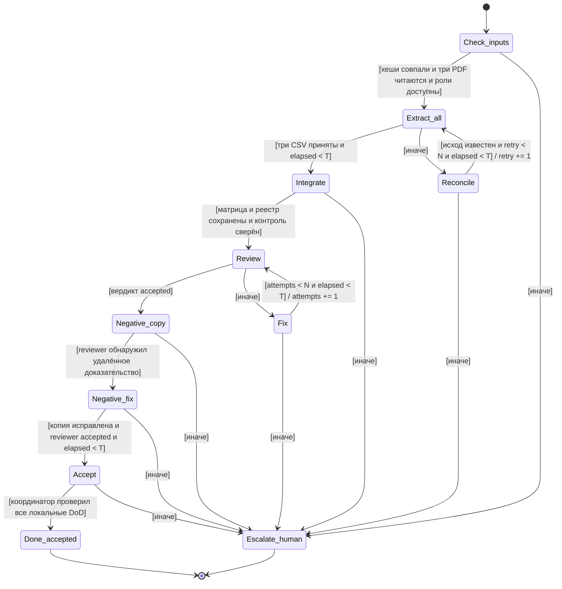

# Граф SA08 — принят до предметных workers

## Владельцы и наблюдения

Check_inputs — координатор + explorer /root/sa08_inputs: хеш ZIP, визуальная читабельность трёх PDF, наличие явных типов ролей. Предыдущая остановка из-за ролей — отдельный preflight, не предметный прогон.

Extract_all — три параллельных worker: contract, appendix, specification. Внутри этого агрегированного плоского состояния разрешены независимые ветви T2/T3/T4. Каждый получает свой PDF, contract.md, свой worktree и пишет разные файлы. Join разрешён только после получения и проверки всех трёх CSV, а не первого ответа. Это пояснение параллельности, не формальный fork/join, который checker не поддерживает.

Reconcile — координатор проверяет agent status, файлы, хеши, завершение процесса и журнал. При неизвестном исходе не повторяет операцию до установления живого состояния. При завершённом успешном результате использует существующий артефакт. Повтор разрешён только при доказанном сбое, иначе Escalate_human.

Integrate — один worker синтеза после приёмки трёх входов, координатор сохраняет первый результат до чтения checks. Review — отдельный reviewer читает исходные PDF и результаты, возвращает accepted либо список доказанных дефектов. Исполнитель не ревьюит сам себя. Fix — прежний worker исправляет перечисленные дефекты.

Negative_copy — координатор создаёт отдельную копию результатов без исходных PDF, удаляет доказательство одного вывода; отдельный reviewer проверяет копию вслепую по тому же контракту. Negative_fix — координатор восстанавливает доказательство, reviewer повторно проверяет. Эта ограниченная последовательность не содержит дополнительной петли.

Accept — координатор проверяет артефакты, ссылки, воспроизводимость, журнал реальных запусков, независимый отчёт, отрицательный сценарий и соответствие всем предметным критериям. Done_accepted — только локальная приёмка. PR, приёмка преподавателя и merge отражаются отдельно, отсутствие опубликованного PR не выдаётся за полную сдачу.

## Пределы

N=2, T=90 минут суммарно с 2026-11-15T10:42:22Z. Параллелизм — максимум 3 открытых субагента. Паузы и повторы не сбрасывают время.

Петля Extract_all → Reconcile → Extract_all: retry начинается с 0, увеличивается перед повтором, повтор при retry < N и elapsed < T, иначе остановка. Петля Review → Fix → Review: attempts начинается с 0, увеличивается перед повторным ревью, максимум N кругов и исходный срок T. Любое превышение срока ведёт в Escalate_human. Эскалация завершает текущий запуск.

## Проверка

Структурная эвристика graph_check проверяет плоские переходы, достижимость, fallback и наличие ограничений циклов. Она не доказывает смысл условий, увеличение счётчика, реальную параллельность или фактическое исполнение. Рендер и визуальная проверка сохраняются отдельно до запуска workers.
