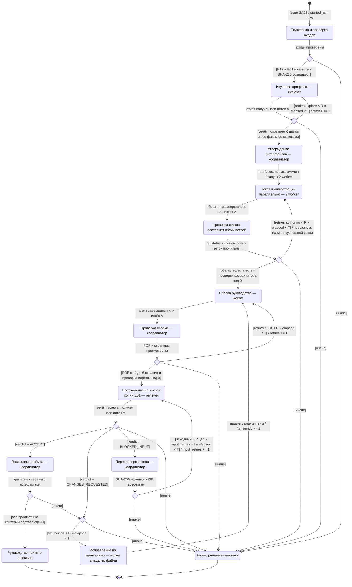

# SA03 — граф выполнения

Граф управляет запуском кейса SA03: иллюстрированное руководство по процессу
H12, проверенное на чистой копии комплекта E01. Координатор — основная сессия
Claude Code. Исполнители — нативные субагенты Claude Code (инструмент Agent),
каждый в отдельном процессе с собственным брифом. Codex в этом запуске не
используется: решение слушателя записано в README и run-log.

Граф утверждён до запуска исполнителей. Каждое изменение графа после старта
фиксируется в run-log с причиной.

## Параметры запуска (выбраны до старта)

| Параметр | Значение | Где учитывается |
| --- | --- | --- |
| N — круги исправления после замечаний reviewer или приёмки | 2 | `fix_rounds`, ребро `fix_gate → Fix` |
| R — повторный запуск фазы после ошибки, таймаута или неполного результата | 1 на фазу | `retries[фаза]`, рёбра `*_check → фаза` |
| I — повтор проверки при недоступном входе | 1 | `input_retries`, ребро `input_gate → Review` |
| T — общий срок запуска от `Prepare` | 4 ч | `elapsed`, все рёбра повтора |
| A — таймаут одного субагента | 40 мин | исход «таймаут» в `*_check` |
| P — предел параллелизма пишущих агентов | 2 | только фаза `Authoring` |

`started_at` записывается в run-log при входе в `Prepare`. Счётчики и срок не
обнуляются при возврате в фазу, при новом круге исправления и при восстановлении.

## Граф

## Состояния

### Prepare — координатор

Вход: issue #54 (SA03), #48 (H12), #7 (E01). Действие: создать интеграционную
ветку `student/arystanabyl/SA03` и worktree исполнителей, записать `started_at`,
пересчитать SHA-256 `downloads/H12.zip` и `downloads/E01.zip` и сравнить со
значениями из issue #48 и #7. Наблюдение: вывод `git worktree list` и хэши в
run-log.

`inputs_gate`: оба ZIP на месте и хэши совпадают — к `Explore`. Иначе вход
недоступен: продолжать по догадке нельзя, `Escalate_human`.

### Explore — explorer (`Explore`, только чтение)

Бриф: `briefs/01-explore.md`. Вход: материалы H12 и E01, README репозитория,
issue #48 и #7. Выход: отчёт с инвентарём шести шагов `process.md`, точными
именами файлов, путями, командами Windows и ссылками на источник каждого факта.
Сам агент файлы не пишет; координатор сохраняет отчёт без правок как
`research/process-notes.md`.

`explore_check`: координатор сверяет, что описаны все шаги S1–S6 и у каждого
факта есть путь к источнику. Ошибка, таймаут A или пропуск шага — один
перезапуск с указанием пропуска (R), затем эскалация.

### Freeze — координатор

Координатор утверждает `interfaces.md`: ID шагов S1–S6, ID и имена рисунков
fig-01…fig-06, размеры 1600×900, подписи рисунков, схему путей, разбивку по
страницам и формат передачи. После коммита интерфейса две ветви Authoring
независимы: текст пишет только `text/`, иллюстрации пишут только `figures/`.
Обе ветви читают общие входы и `interfaces.md` и не читают выходы друг друга.

### Authoring — 2 worker (`general-purpose`) параллельно, P = 2

- `SA03-text`: бриф `briefs/02-text.md`, worktree `Training-SA03/text`,
  выход `text/steps.md`.
- `SA03-figures`: бриф `briefs/03-figures.md`, worktree
  `Training-SA03/figures`, выход `figures/*.svg`, `figures/*.png`,
  `figures/PROVENANCE.md`.

### Join и join_check — координатор

Объединение начинается только после завершения обеих ветвей. Координатор не
полагается на отчёт агента, а читает живое состояние: `git -C worktree status`,
`git log`, список файлов и проверки из `interfaces.md` (наличие шести шагов,
шесть PNG размером 1600×900, изменения только в своей папке). Если исход
неизвестен (агент упал или истёк A), то же чтение показывает, что реально
сделано: перезапускается только неуспешная ветвь, а готовая сохраняется.
Обе ветви успешны — их коммиты вливаются в интеграционную ветку и начинается Build.

### Build и BuildInspect

Worker `SA03-build` (`general-purpose`, бриф `briefs/04-build.md`, worktree
`Training-SA03/build`) собирает `guide/guide.html` и `guide/guide.pdf`,
рендерит страницы в `evidence/pages/` и пишет `evidence/layout-check.md`.
Координатор сам считает страницы PDF и просматривает каждую. `build_check`
пропускает дальше только 4–6 страниц и вёрстку без находок.

### Review — reviewer (`claude`, отдельный агент)

Бриф `briefs/05-review.md`, worktree `Training-SA03/review`, запись только в
`reviews/`. Reviewer не участвовал в написании. Он идёт по `guide.pdf` на
новой копии E01 в своей временной папке, сверяет каждый шаг и иллюстрацию,
проверяет страницы на читаемость, наложения и обрезку. Verdict — одно из трёх:
`ACCEPT`, `CHANGES_REQUESTED` (список замечаний с номером страницы и шага),
`BLOCKED_INPUT` (шаг нельзя выполнить из-за входа, а не из-за текста).

### InputRecheck — координатор

Используется при `BLOCKED_INPUT`. Координатор не повторяет проверку вслепую:
сначала пересчитывает SHA-256 исходного `downloads/E01.zip` и сверяет его с
issue #7. Исходник цел — значит, повреждена копия у reviewer; запускается
новый Review на свежей копии (не больше I). Исходник повреждён или лимит
исчерпан — `Escalate_human`.

Контролируемый отрицательный сценарий запуска: первый Review получает
усечённую копию ZIP (имитация оборванной загрузки) без права скачать заново.
Ожидается, что reviewer остановится на шаге проверки SHA-256 и вернёт
`BLOCKED_INPUT`. Ветвь считается пройденной только при наблюдаемом verdict в
отчёте.

### fix_gate и Fix

`Fix` выполняет новый worker, который владеет затронутым файлом: текст —
`text/`, рисунки — `figures/`, вёрстка — `guide/`. Работа идёт в той же
worktree-ветке, по одному владельцу на файл. После правок — обязательная
пересборка и новый Review: замечание reviewer снимает только reviewer.

### Accept — координатор

Сверка предметных критериев SA03 с артефактами: 4–6 страниц, редактируемый
исходник, иллюстрации ко всем шагам без противоречий тексту, прохождение на
чистой копии E01 записано, страницы просмотрены, происхождение изображений
указано, `materials/` не изменён. Любой неподтверждённый критерий ведёт к
`fix_gate`.

## Финалы

- **Done_accepted** — локальная приёмка координатором по предметным критериям.
  Это не приёмка преподавателем и не merge: PR сливает только преподаватель.
- **Escalate_human** — запуск остановлен. В run-log записывается, что
  требовалось, что проверено, какие счётчики использованы и какое решение
  нужно от слушателя. Повтор начинается только по решению человека, с
  явно указанного состояния.

## Пределы

| Петля | Условие | Счётчик | Источник предела |
| --- | --- | --- | --- |
| `explore_check → Explore` | `retries explore < R и elapsed < T` | `retries.explore`, +1 при перезапуске | R = 1, выбрано до старта |
| `join_check → Authoring` | `retries authoring < R и elapsed < T` | `retries.authoring`, общий для обеих ветвей | R = 1 |
| `build_check → Build` | `retries build < R и elapsed < T` | `retries.build` | R = 1 |
| `input_gate → Review` | `input_retries < I и elapsed < T` | `input_retries`, +1 на ребре | I = 1 |
| `fix_gate → Fix → Build → … → Review` | `fix_rounds < N и elapsed < T` | `fix_rounds`, +1 после Fix | N = 2 |

Каждый цикл, кроме того, ограничен общим сроком `T = 4 ч` от `started_at`.
Повторный вход в Build после Fix не обнуляет `retries.build`, а новый Review
не обнуляет `input_retries`.

## Проверка графа

Структурная проверка: `python <skill>/scripts/graph_check.py workflow.md`
(учебный скилл agent-behavior-graph). Результат и рендер Mermaid — в
`evidence/graph-check.txt` и `evidence/workflow.png`. Ограничение: checker —
эвристика. Он не доказывает, что счётчики меняются и процесс реально идёт по
графу. Это подтверждает run-log.
