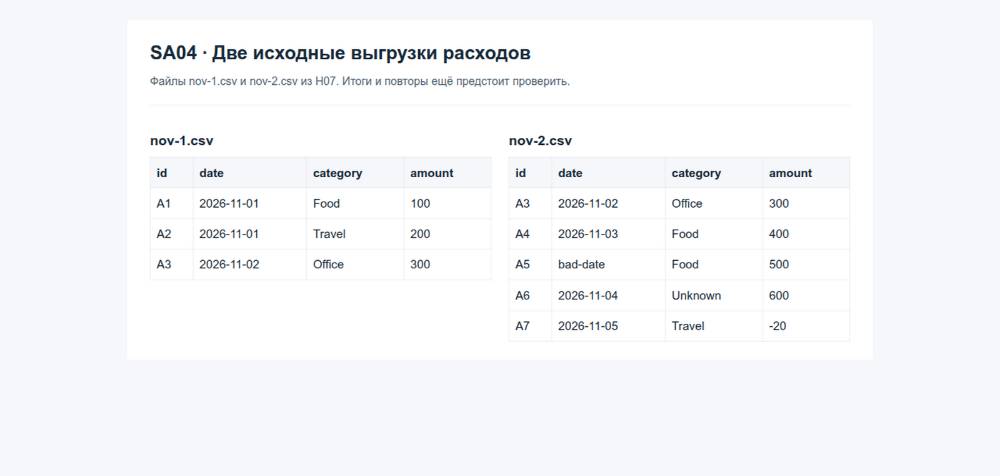

## Outcome

Автоматизируй сводный отчёт о расходах учебного центра «Вектор» по двум CSV: очищенные данные, реестр ошибок и показатели для директора должны выпускаться одним воспроизводимым запуском.

**Исполнитель:** @mairamaidan. **Код:** SA04. **Тема:** день 2 курса, декомпозиция и выполнение по графу с нативными субагентами Codex.

Дополнительный результат этого упражнения — самостоятельно превратить постановку в GitHub-веху с подзадачами и выполнить её по проверяемому графу, используя несколько типов субагентов.

<!-- course-task-illustration:SA04:v1 -->
## Как выглядит объект задания

Так выглядят две исходные выгрузки расходов. Заголовки задают поля записей; сверка строк, обработка ошибок и итоговый отчёт выполняются в задании.

*Источник: учебный комплект; [происхождение и права на изображения](https://github.com/ARepnikov777/Training/blob/b4aaafa248f4d159e492a470ddb26bf0fbd1ae7d/assets/task-illustrations/README.md). Иллюстрация поясняет исходные материалы и не заменяет условия и критерии ниже.*

<!-- /course-task-illustration:SA04:v1 -->

## Ситуация и заказчик

Администратор учебного центра **«Вектор»** собирает расходы на проведение занятий из двух CSV-выгрузок. Часть операций попала в обе выгрузки, а в некоторых строках ошибочны дата, категория или сумма. Сейчас администратор вручную сводит таблицы перед передачей директору. Нужен небольшой воспроизводимый конвейер, который отделит пригодные операции от проблемных и выпустит отчёт.

Выданы `nov-1.csv` и `nov-2.csv` — небольшой контрольный срез операций за начало ноября 2026 года, а не бухгалтерская база организации. В этом кейсе суммы считаются **KZT**. Поля: `id,date,category,amount`. Категории `Food`, `Travel`, `Office` отображаются как «Еда», «Транспорт», «Канцелярия». Правила даты, суммы и устранения полных повторов определены в `input/rules.json`.

Директору важно увидеть сумму расходов и структуру по категориям, а администратору — получить строки, которые надо исправить у источника. Ошибку нельзя молча превратить в ноль, неизвестную категорию нельзя самовольно отнести к «Прочему», а повтор выгрузки не должен увеличить расходы. Налоговые правила и полноценный бухгалтерский учёт в задачу не входят.

Все организации, люди, товары и события в этом кейсе вымышленные. Добавленное описание задаёт рабочую ситуацию и получателя результата; факты первичных документов, входные значения, контрольные примеры и ограничения из выданного комплекта сохраняются.

## Что передать заказчику

Передай утилиту и одну документированную команду запуска, выпускающую **`clean.csv`, `rejected.csv` и `report.md`**. В отклонённых строках сохрани исходную строку, её источник и причину отказа. В отчёте укажи обработанные файлы, число пригодных уникальных операций, общую сумму и суммы категорий. Отдельно объясни баланс: входные строки = принятые уникальные + исключённые полные повторы + ошибочные.

**Сценарий использования:** администратор запускает обработку на двух выданных CSV, открывает отчёт директору и передаёт список ошибок на исправление. Второй запуск на тех же входах не меняет итог и не накапливает дубли. Reviewer сверяет результат по исходным строкам и контрольным данным, а не только по сообщению «обработка завершена».

## Входные материалы и границы

- Предметная основа: [исходное задание H07 — Создать воспроизводимый локальный отчёт по данным](https://github.com/ARepnikov777/Training/issues/43).
- [Скачать готовый комплект H07.zip](https://raw.githubusercontent.com/ARepnikov777/Training/22aad84cc6666d2b0abca011e95a96b12e69c9cd/downloads/H07.zip). Прочитай README, input и уточнения исходного issue. Точные правила и контрольные данные не придумывай.
- Условия исходного задания о необязательности нескольких агентов относятся к исходному упражнению. В **SA04** действуют дополнительные требования ниже: реальные субагенты, граф, независимое ревью. Предметные требования исходного кейса сохраняются.
- Это отдельное упражнение: старое issue не переназначай, не закрывай автоматически и его решение не перезаписывай. Если оно уже выполнено, можешь использовать свою копию результата как стартовую, явно указав это; выполнение по графу и независимая проверка должны быть новыми и зафиксированными.
- Все данные синтетические. Работа локальная, без production, SSH, платных API и рассылок. Дополнительных материалов от преподавателя не требуется.

## Предметные критерии результата

- Один документированный запуск выполняет загрузку, очистку, проверки, расчёты и выпуск отчёта.
- Повторный запуск на тех же входных файлах даёт те же данные и показатели без накопления дублей.
- Ошибочные записи вынесены отдельно с причиной, баланс строк объяснён.
- Метрики и итоги совпадают с выданными эталонными значениями; в отчёте указаны входные файлы и допущения.

## Задание слушателю: подготовить веху

Создай в этом репозитории отдельную GitHub Milestone с кодом **SA04** и своим логином, назначь ей это issue и созданные тобой подзадачи. В описание вехи внеси итоговый результат и критерии его приёмки. Подзадачи свяжи с этим issue нативной связью sub-issues; одной таблицы ссылок недостаточно. Везде сохрани метку `subagents` и свой assignee.

Декомпозицию выполни сам с агентом. Ориентир — 4–7 ограниченных подзадач, число обоснуй. Для каждой задай входы, выходной артефакт, разрешённые файлы, запреты, зависимости, роль, проверяемый DoD и ветку/worktree. Не дроби работу на декоративные задачи и не поручай разным исполнителям править один общий файл.

**Подсказка по зависимостям, не готовая декомпозиция:** изучение входов → контракт данных → обработка и отчёт → общий прогон → ревью.

**Возможность параллельности:** После фиксации формата очищенных данных можно отдельно готовить очистку и расчёт/отчёт. Общие файлы и итоговый запуск имеют одного владельца. Докажи независимость по входам/выходам. Общие интерфейсы утверди до параллельной реализации. Если параллельная запись не оправдана, обоснуй это и распараллель независимые исследования или проверки.

## Граф выполнения

Подготовь `workflow.md` с Mermaid `stateDiagram-v2` и пояснениями узлов. Граф должен управлять реальным выполнением, а не описывать его задним числом.

- Для каждого рабочего состояния укажи владельца и конкретный тип субагента. Используй **минимум три разных типа**: `explorer`, `worker`, `reviewer`. Основная сессия — координатор. `docs_researcher` добавляй для отдельной проверки API/документации, когда она нужна. Самопроверка worker не считается независимым reviewer.
- Покажи зависимости, разрешённые параллельные ветви и условие их объединения. Координатор проверяет все обязательные результаты до интеграции.
- Переходы зависят от наблюдаемых фактов: кода проверки, наличия артефакта, конкретного вывода reviewer. У каждой развилки — одно ребро `[иначе]`.
- Покажи возврат на исправление после замечания reviewer и предел на ребре нового круга. **До запуска** выбери и запиши N попыток исправления, T общего ожидания и предел параллелизма. В разделе «Пределы» укажи каждую петлю; повторы не обнуляют исходный срок и счётчики.
- Предусмотри недоступный вход, ошибку исполнителя/таймаут и неизвестный исход операции: сначала проверка живого состояния, затем обоснованный повтор либо остановка. Обязательные финалы: `Done_accepted` и `Escalate_human`; эскалация завершает текущий запуск, а не запускает бесконечный повтор.
- `Done_accepted` означает локальную приёмку координатором по предметным критериям. Приёмка преподавателем и merge PR остаются отдельным действием человека.

**Характерная проверка для этого кейса:** баланс строк или контрольная метрика не совпадают с ожидаемым значением. Выбери безопасный отрицательный сценарий на копии материалов, который действительно проверит соответствующую развилку графа. Не утверждай, что ветка пройдена, если её только нарисовал.

## Work mode и выполнение

**Сейчас преподаватель выдаёт только исходную задачу.** Веху, подзадачи, граф и запуск создаёшь ты на практике. Не выдавай создание схемы за выполнение кейса.

- После подготовки и проверки графа запусти реальные нативные субагенты в Codex с входом ChatGPT. Настройка: [готовый промпт](https://github.com/mbk-dev/ai-learning/blob/main/docs/codex-native-subagents-setup-prompt.md). API-ключи, OpenCode и OpenRouter не нужны.
- Рабочий каталог каждого исполнителя — его явный checkout/worktree репозитория `ARepnikov777/Training`; область записи только `submissions/mairamaidan/SA04/`. Интеграционная ветка — `student/mairamaidan/SA04`. Рабочие ветки — `student/mairamaidan/SA04-ИМЯ`. Параллельным пишущим агентам — разные worktree и разные выходные файлы. Не меняй `materials/`, `downloads/`, общие инструменты и результаты других слушателей.
- Исполнитель делает ограниченную работу и возвращает ссылки на файлы и проверки. Координатор самостоятельно сверяет их, интегрирует результат и передаёт его отдельному reviewer. Субагенты не переделегируют работу, не делают push, merge и внешнюю публикацию самостоятельно.
- Сохраняй прогресс в `submissions/mairamaidan/SA04/run-log.md`: время, run/agent ID (если доступен), тип субагента, состояние, наблюдаемый результат, выбранный переход, попытка, артефакт и проверка. Не публикуй секреты и полные приватные истории чата. Лог без доступных идентификаторов дополни свидетельством реальных запусков из интерфейса/отчёта Codex.
- Сохрани отдельные брифы и отчёт reviewer. Покажи хотя бы один успешный сквозной прогон и один контролируемый отрицательный сценарий с исправлением или корректной эскалацией. Для кода сохраняй релевантные тесты до/после исправления, для документов и графики — предметную и визуальную проверку.
- Модели выбирай из доступных в аккаунте. Недоступную роль/модель зафиксируй и настрой до запуска; самовольная имитация нескольких ролей одной сессией не засчитывается. Повторную настройку среды не превращай в предметную реализацию.

## Definition of Done (DoD)

- [ ] Предметный результат удовлетворяет **всем** предметным критериям и формату раздела «Что передать заказчику»; в README для каждого есть отдельное доказательство, исходные материалы сохранены.
- [ ] Создана персональная GitHub-веха с результатом и критериями приёмки; это issue и нативно связанные подзадачи включены в неё, зависимости/владельцы/области записи определены и доступны по ссылкам.
- [ ] До реализации сохранён и проверен граф с минимум тремя типами субагентов, обоснованной параллельностью, наблюдаемыми условиями, ограниченными повторами, локальной приёмкой и эскалацией. Mermaid отрендерен и просмотрен; структурная проверка записана с её ограничениями.
- [ ] Журнал и артефакты подтверждают реальные запуски `explorer`, `worker`, отдельного `reviewer`, успешную интеграцию и выбранный отрицательный сценарий; замечания reviewer исправлены либо явно оставлены как блокеры, локальный успех не объявлен при невыполненных критериях.
- [ ] В одном PR в `main` переданы результат, исходники, `workflow.md`, брифы, `run-log.md`, отчёт reviewer и README с командами/порядком повторения. Ссылки на веху, подзадачи и PR добавлены в это issue; объединение PR оставлено преподавателю.

## Сдача и источники

Следуй [правилам сдачи репозитория](https://github.com/ARepnikov777/Training#подготовка-и-сдача-задания), используя код `SA04` вместо E01. В PR укажи номер этого issue в строке «Задание: …», без `Closes`; один PR на весь этот кейс, промежуточные ветки не публикуй без необходимости. Шаблон PR дополни кодом `SA04` и ссылками на граф/веху.

Граф и критерии: [учебный agent-behavior-graph](https://github.com/mbk-dev/ai-learning/blob/main/skills/agent-behavior-graph/SKILL.md), [проверяющий скрипт](https://github.com/mbk-dev/ai-learning/blob/main/skills/agent-behavior-graph/scripts/graph_check.py), [учебный AGENTS.md](https://github.com/mbk-dev/ai-learning/blob/main/AGENTS.md). Проверяющий скрипт — эвристика; он не доказывает фактическое выполнение графа.

<!-- course-subagents:SA04:mairamaidan -->

## Декомпозиция SA04

Веха: [SA04 · mairamaidan](https://github.com/ARepnikov777/Training/milestone/4).

Шесть подзадач выбраны по отдельным результатам и областям записи:

1. T1 — #102: исследование H07 (`explorer`).
2. T2 — #103: интерфейсы, брифы и проверенный граф (координатор).
3. T3 — #104: очистка CSV (`worker`).
4. T4 — #105: расчёт и отчёт (`worker`).
5. T5 — #106: интеграция, повторный запуск и отрицательный сценарий (`worker`).
6. T6 — #107: независимое ревью (`reviewer`) и подготовка сдачи координатором.

Порядок: #102 → #103 → (#104 и #105 параллельно) → #106 → #107. У T3 и T4 разные файлы и worktree, общий контракт утверждается до реализации. Общую интеграцию выполняет один владелец. Роли, входы/выходы, ограничения и DoD заданы в каждой подзадаче; связи sub-issues нативные.

Текущее состояние: выполнена только организация вехи и декомпозиция. Реализация, граф и запуски субагентов ещё не выполнены. Исходные критерии выше сохраняются; #55 остаётся открытой до приёмки преподавателем.
