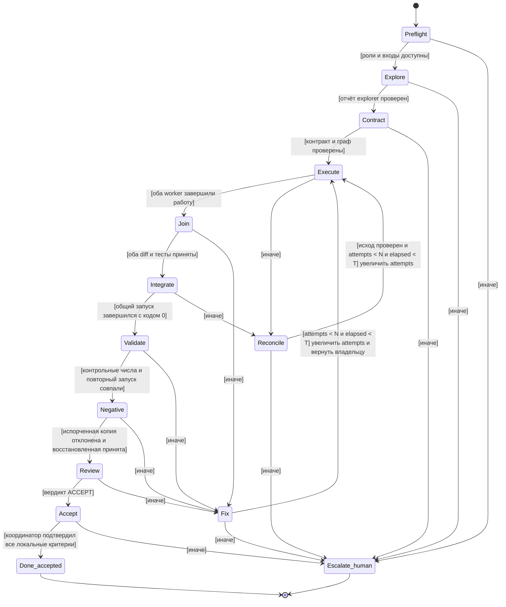

# SA04 — граф выполнения

## Контракт запуска 2

Цель: воспроизводимый отчёт H07, доказательства и независимая локальная приёмка по #55. Координатор — `/root`. Только нативные роли Codex через текущий вход ChatGPT. Публикация одного учебного PR входит в поручение выполнить веху; merge и закрытие #55 остаются преподавателю.

## Владельцы и наблюдения

| Состояние | Владелец | Вход, действие и проверяемый выход |
|---|---|---|
| Preflight | координатор | Ветка/status, наличие H07, отсутствие дублей агентов, явный agent_type; недоступный вход завершает запуск |
| Explore | explorer T1 | Только чтение README, input, checks и постановки; координатор сохраняет неизменённый отчёт research/input-facts.md и проверяет ссылки |
| Contract | координатор + reviewer графа | interfaces.md, брифы, план, структурная проверка и просмотр Mermaid до реализации |
| Execute | два worker T3/T4 | После контракта запускаются параллельно в отдельных worktree: cleaning.py/test_cleaning.py и reporting.py/test_reporting.py; повтор запускает только владельца дефекта, готовые результаты не дублируются |
| Join | координатор | Сверка разрешённых файлов, diff и тестов ОБОИХ исполнителей; интеграция только после двух принятых результатов |
| Integrate | worker T5 | Единственный владелец pipeline.py, общего запуска и независимой проверки выходов; потребляет контракт двух модулей |
| Validate | координатор | Тесты и CLI: 8 = 4 + 1 + 3, 1000 KZT, категории 500/200/300; два запуска без накопления, запуск в чистом каталоге |
| Negative | координатор | На отдельной копии удалить запись clean.csv, получить ненулевой код проверки; восстановить копию и получить 0 |
| Review | отдельный reviewer T6 | Независимое чтение исходников, diff, доказательств и результатов; ACCEPT / CHANGES_REQUESTED / BLOCKED_INPUT |
| Fix | координатор → прежний worker | Конкретное замечание и владелец; повторные TDD/проверки, затем тот же reviewer |
| Reconcile | координатор | При ошибке/таймауте/неизвестном исходе сначала проверить живой статус агента, файлы и внешние записи. Не запускать дубль при неизвестном состоянии |
| Accept | координатор | Самостоятельная сверка DoD, README, журнала, отчёта reviewer. Локальная приёмка отдельно от сдачи |
| Done_accepted | координатор | Подтверждённая локальная приёмка; сдача одним PR отдельным шагом, merge преподавателем |
| Escalate_human | координатор | Финал с причиной, оставшимися артефактами и точкой продолжения; автоматического нового круга нет |

## Пределы

Выбор координатора до запуска: N = 2 общих возврата на исправление/восстановление; T = 5400 секунд от времени старта запуска 2 в run-log.md; максимум 3 одновременно открытых субагента. Готовые агенты не считаются активными. Время, attempts, ID и результаты сохраняются при восстановлении.

Обе петли `Fix → Execute` и `Reconcile → Execute` увеличивают один общий attempts до возврата; исходный срок не сбрасывается. Ожидание каждого агента ограничено общим T, ошибки и истечение срока направляются через Reconcile в Escalate_human. Координатор проверяет elapsed перед каждым запуском/возвратом и после ожидания. На всех остальных ошибках Explorer/Contract/Accept — остановка без повторов.

Checker проверяет плоскую структуру, достижимость и наличие границ эвристически; не доказывает смысл условий, увеличение счётчиков, реальное делегирование или корректность данных. Параллельность Execute описана таблицей: один узел объединяет два независимых worktree, Join ожидает оба результата.
