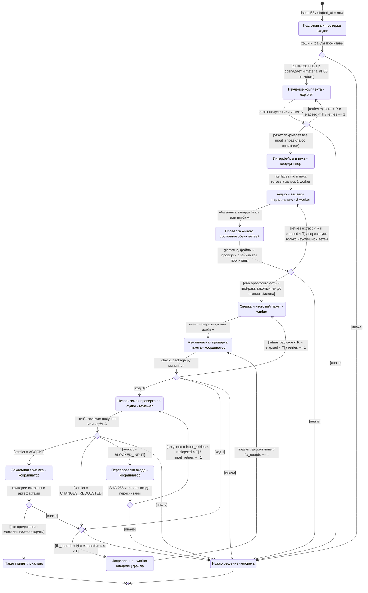

# SA07: граф выполнения

Граф управляет запуском кейса SA07: рабочий пакет по планёрке практикума
«Орион» (протокол, реестр поручений, реестр расхождений) из записи
`materials/H06/input/meeting.mp3` и черновика `materials/H06/input/notes.md`.

Координатор - основная сессия Claude Code. Исполнители - нативные субагенты
Claude Code (инструмент Agent), каждый отдельным процессом со своим брифом.
Почему не Codex: у аккаунта ChatGPT слушателя исчерпан лимит Codex (до
14.12.2026), а роли `gpt-6.1-terra` и `gpt-6.1-sol` со входом ChatGPT не
поддерживаются. Решение слушателя записано в README и run-log.

Граф утверждён и закоммичен до запуска первого субагента. Любое изменение
графа после старта записывается в run-log с причиной.

## Параметры запуска (выбраны до старта)

| Параметр | Значение | Где учитывается |
| --- | --- | --- |
| N - круги исправления (после Validate или Review) | 2 | `fix_rounds`, ребро `fix_gate → Fix` |
| R - повтор фазы после ошибки, таймаута или неполного результата | 1 на фазу | `retries[фаза]`, рёбра `*_check → фаза` |
| I - повтор Review после недоступного входа | 1 | `input_retries`, ребро `input_gate → Review` |
| T - общий срок запуска от `Prepare` | 4 ч | `elapsed`, все рёбра повтора |
| A - таймаут одного субагента | 40 мин | исход «таймаут» в `*_check` |
| P - предел параллелизма пишущих агентов | 2 | только фаза `Extract` |

`started_at` пишется в run-log при входе в `Prepare`. Счётчики и срок не
обнуляются при возврате в фазу, при новом круге исправления и при
восстановлении после сбоя.

## Граф

## Состояния

### Prepare - координатор

Вход: issue #58 (SA07), #42 (H06). Действие: записать `started_at`, пересчитать
SHA-256 `downloads/H06.zip` и сравнить с #42
(`16414ca4…ebeee`), сверить `materials/H06/input` с содержимым ZIP, создать
worktree исполнителей. Наблюдение: хэши и `git worktree list` в run-log.

`inputs_gate`: хэш совпадает и файлы на месте - к `Explore`. Иначе вход
недоступен, догадкой его не заменяем: `Escalate_human`.

### Explore - explorer (тип `Explore`, только чтение)

Бриф `briefs/01-explore.md`. Вход: README и input комплекта, issue #42 и #58.
Запрет: открывать `checks/` (там эталон). Выход: отчёт с правилами,
форматами, ограничениями и ссылками на источник каждого факта. Агент файлы не
пишет, координатор сохраняет отчёт без правок как `research/kit-facts.md`.

`explore_check`: все файлы input и все уточнения #42 разобраны, у каждого
факта путь к источнику, `checks/` не открывался. Иначе один перезапуск (R).

### Freeze - координатор

Утверждает `interfaces.md` (словарь тем и видов событий, форматы CSV,
таймкодов и ссылок на заметки), `tools/check_package.py`, создаёт веху и
подзадачи на GitHub. Создание вехи и issue - внешнее действие: при неизвестном
исходе сначала читается список вех и issue, повторное создание только если
объекта нет.

### Extract - 2 worker (`general-purpose`) параллельно, P = 2

- `SA07-audio`: бриф `briefs/02-audio.md`, worktree
  `../SA07-wt/audio`, ветка `student/wilddancer-oss/SA07-audio`. Выход:
  `asr/first-pass.json|md`, `asr/method.md`, `asr/transcribe.py`,
  `extract/audio-events.csv`. Первый результат распознавания коммитится
  отдельным коммитом до любых следующих шагов.
- `SA07-notes`: бриф `briefs/03-notes.md`, worktree `../SA07-wt/notes`,
  ветка `student/wilddancer-oss/SA07-notes`. Выход: `extract/notes-claims.csv`.

Независимость: audio читает только `meeting.mp3` и `audio-info.json`, notes
читает только `notes.md`. Общий только `interfaces.md` (утверждён в Freeze).
Выходные файлы не пересекаются. Обоим запрещено открывать `checks/`.

### Join и join_check - координатор

Начинается после завершения обеих ветвей. Координатор не верит отчёту, а
читает живое состояние: `git -C <worktree> status`, `git log`, список файлов,
изменения только в своих путях, заголовки CSV по интерфейсу, коммит
first-pass есть и в нём нет файлов из `checks/`. При ошибке или таймауте
(неизвестный исход) это же чтение показывает, что реально сделано:
перезапускается только неуспешная ветвь, готовая сохраняется. Обе успешны -
ветки вливаются в `student/wilddancer-oss/SA07`.

### Package - worker (`general-purpose`)

Бриф `briefs/04-package.md`, worktree `../SA07-wt/package`, ветка
`student/wilddancer-oss/SA07-package`. Только теперь открывается эталон:
`checks/transcript.md`, `checks/timeline.json`, остальные `checks/`. Выход:
`asr/corrections.md`, `result/minutes.md`, `result/tasks.csv`,
`result/contradictions.csv`. Владелец один, файлы других веток не правит. Если
нашёл ошибку в `extract/*.csv`, сообщает координатору, а не правит сам.

### Validate и validate_check - координатор

`python3 -I tools/check_package.py .` в worktree package. Код 0 - к Review.
Код 1 (находки) - к `fix_gate`. Код 2, нет файлов, агент упал - повтор
Package (R), затем эскалация.

**Контролируемый отрицательный сценарий** (только при первом Validate):
координатор отдельным помеченным коммитом добавляет в `result/tasks.csv`
строку «заказать кофе-брейк за 25000 KZT» с таймкодом исходного предложения.
Это ровно характерная ошибка кейса: отменённый кофе-брейк в действующем плане
и таймкод, который не подтверждает решение. Ожидание: код 1 с находками про
отменённую тему и про таймкод, переход `validate_check → fix_gate → Fix`.
Ветвь пройдена только если код 1 и находки реально видны в выводе.

### Review - reviewer (тип `claude`, отдельный агент)

Бриф `briefs/05-review.md`, worktree `../SA07-wt/review`, запись только в
`reviews/`. Reviewer не участвовал в работе. Он проверяет спорные места по
звуку: вырезает и заново распознаёт фрагменты MP3 вокруг таймкодов задач и
расхождений, сверяет с эталоном и заметками, ищет отменённое в действующем
списке, выдуманных ответственных и сроки. Verdict одно из трёх:
`ACCEPT`, `CHANGES_REQUESTED` (замечания с файлом, строкой, таймкодом),
`BLOCKED_INPUT` (вход недоступен или повреждён).

### InputRecheck - координатор

При `BLOCKED_INPUT`: пересчитать SHA-256 ZIP и файлов `materials/H06`. Вход
цел - новый Review на свежей копии (не больше I). Вход повреждён или предел
исчерпан - `Escalate_human`.

### fix_gate и Fix

`Fix` делает новый worker, который владеет затронутым файлом: `result/` и
`asr/corrections.md` - ветка package, `extract/audio-events.csv` и `asr/` -
ветка audio, `extract/notes-claims.csv` - ветка notes. Бриф получает только
наблюдаемые находки (вывод проверки или отчёт reviewer). После правок всегда
`Validate`, затем новый `Review`: замечание reviewer снимает только reviewer.

### Accept - координатор

Сверка предметных критериев #58 с артефактами: три файла есть; решения и
расхождения с таймкодами и ссылками на заметки; отменённое не в действующем
списке, история понятна; ответственные и сроки из источников или `не указан`;
первый результат распознавания закоммичен раньше чтения эталона, есть способ и
список исправлений; `materials/` и `downloads/` не изменены. Любой
неподтверждённый критерий ведёт к `fix_gate`.

## Финалы

- **Done_accepted** - локальная приёмка координатором по предметным
  критериям. Это не приёмка преподавателем и не merge.
- **Escalate_human** - запуск остановлен. В run-log пишется, что требовалось,
  что проверено, какие счётчики использованы и какое решение нужно от
  слушателя. Продолжение только по решению человека с явно указанного
  состояния.

## Пределы

| Петля | Условие | Счётчик | Источник предела |
| --- | --- | --- | --- |
| `explore_check → Explore` | `retries explore < R и elapsed < T` | `retries.explore`, +1 при перезапуске | R = 1 до старта |
| `join_check → Extract` | `retries extract < R и elapsed < T` | `retries.extract`, общий для обеих ветвей | R = 1 |
| `validate_check → Package` | `retries package < R и elapsed < T` | `retries.package` | R = 1 |
| `input_gate → Review` | `input_retries < I и elapsed < T` | `input_retries` | I = 1 |
| `fix_gate → Fix → Validate → … → fix_gate` | `fix_rounds < N и elapsed < T` | `fix_rounds`, +1 на ребре `Fix → Validate`, общий для замечаний Validate, Review и Accept | N = 2 |

Таймаут A не создаёт петлю сам по себе: истёкший агент даёт исход «иначе» или
повтор в пределах R. Ни один возврат не обнуляет `elapsed`, `retries`,
`fix_rounds`, `input_retries`.

## Проверка графа

- `graph_check.py` из учебного скилла agent-behavior-graph:
  `evidence/graph-check.txt` (код и мутации). Это эвристика, она не доказывает
  фактическое выполнение.
- Рендер: `evidence/workflow.png`, просмотрен координатором.
- Фактический путь - в `run-log.md`.
