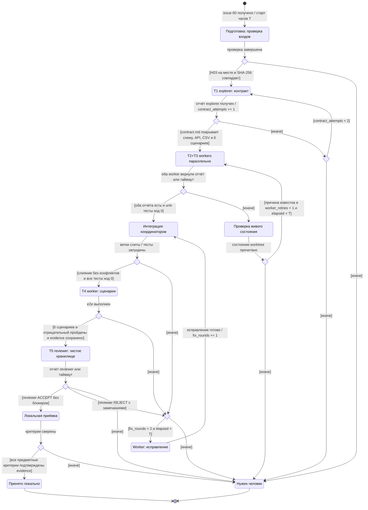

# SA09 — граф выполнения

Задание: [#60](https://github.com/ARepnikov777/Training/issues/60). Координатор — основная сессия Claude Code (пользователь `zekayessss` + агент).
Граф составлен и проверен **до** запуска исполнителей; фактическое прохождение фиксируется в `run-log.md`.

## Типы субагентов (Claude Code)

Работа ведётся в Claude Code, а не в Codex (решение слушателя, зафиксировано в README). Роли сопоставлены с нативными типами субагентов Claude Code:

| Роль курса | Тип субагента Claude Code | Права | Почему подходит |
|---|---|---|---|
| `explorer` | `Explore` | только чтение | исследует материалы, не может ничего изменить |
| `worker` | `general-purpose` + `isolation: worktree` | запись только в свой worktree | пишет код в изолированной копии репозитория |
| `reviewer` | `Plan` | чтение + запуск команд, **без записи файлов** | может запустить приложение и тесты, но не может «поправить» то, что проверяет |

Координатор — основная сессия: выдаёт брифы, сверяет результаты, интегрирует ветки, сохраняет отчёты субагентов в файлы.

## Подзадачи и владельцы

| Узел | Подзадача | Тип | Выход | Область записи | Ветка |
|---|---|---|---|---|---|
| `Explore_contract` | T1 Контракт | `Explore` | `contract.md` (сохраняет координатор) | — (только чтение) | `student/zekayessss/SA09` |
| `Parallel_impl` | T2 Хранение и CSV | `general-purpose` | `app/store.py`, `app/server.py`, `tests/test_store.py` | только эти файлы | `student/zekayessss/SA09-storage` |
| `Parallel_impl` | T3 Интерфейс | `general-purpose` | `app/static/*` | только `app/static/` | `student/zekayessss/SA09-ui` |
| `Scenarios` / `Fix` | T4 Сценарии и исправления | `general-purpose` | `tests/test_e2e.py`, `evidence/` | `tests/test_e2e.py`, `evidence/`, файлы из замечания | `student/zekayessss/SA09-scenarios` |
| `Review` | T5 Независимое ревью | `Plan` | `review.md` (сохраняет координатор) | — (только чтение) | `student/zekayessss/SA09` |

Все пути выше — относительно `submissions/zekayessss/SA09/`. Никто не пишет в `materials/`, `downloads/`, `tools/` и чужие `submissions/`.

## Пределы (выбраны до запуска)

| Параметр | Значение | Где учитывается |
|---|---|---|
| **N** — круги исправления | **2** | ребро `fix_gate → Fix` `[fix_rounds < 2]`; `fix_rounds` растёт на ребре `Fix → Integrate`, стартует с 0 и не обнуляется |
| **T** — общее время запуска | **3 часа** от входа в `Prepare` | рёбра `live_ok → Parallel_impl` и `fix_gate → Fix`; часы не перезапускаются при возвратах |
| Попытки контракта | **2** | ребро `contract_retry → Explore_contract` `[contract_attempts < 2]` |
| Повтор исполнителей после сбоя | **1** | ребро `live_ok → Parallel_impl` `[worker_retries < 1]`; `worker_retries` растёт при входе в `Live_check` |
| Параллелизм | **2** пишущих worker одновременно | только в `Parallel_impl`; остальные узлы последовательны |
| Таймаут одного субагента | **20 минут** | отсутствие отчёта за 20 минут = таймаут, ведёт в ветку `[иначе]` своей развилки |

Петли графа: (1) `Explore_contract → contract_ok → contract_retry → Explore_contract`; (2) `Parallel_impl → impl_ok → Live_check → live_ok → Parallel_impl`; (3) `Integrate → … → fix_gate → Fix → Integrate` (через `integ_ok`, `scen_ok` или `verdict`). Каждая ограничена своим счётчиком, петли 2 и 3 — ещё и общим сроком T.

## Пояснения узлов

**Prepare** (координатор). Проверяет, что `materials/H03/input/{SPEC.md,import-valid.csv,import-mixed.csv}` и `checks/cases.json` на месте, а SHA-256 `downloads/H03.zip` равен значению из issue H03. Не на месте → недоступный вход → `Escalate_human`.

**Explore_contract** (`Explore`). Вход: материалы H03, issue #60. Выход: текст контракта — схема карточки, правила валидации, HTTP API (метод, путь, тело, ответ, коды ошибок), формат хранения, правила импорта/экспорта CSV и формат ошибки строки, сопоставление 6 сценариев `cases.json` с API. Координатор сохраняет его в `contract.md` и проверяет полноту по чек-листу; это и есть утверждение общих интерфейсов до параллельной работы.

**Parallel_impl** (2 × `general-purpose`, каждый в своём worktree). T2 и T3 зависят только от `contract.md`: T2 реализует API и хранение, T3 — страницу, вызывающую API. Файлы не пересекаются (`app/store.py`, `app/server.py`, `tests/` против `app/static/`), поэтому параллельная запись безопасна. Наблюдение — отчёт каждого worker и код возврата `python3 -m unittest` в его worktree, перепроверенный координатором.

**Live_check** (координатор). Неизвестный исход/таймаут/ошибка исполнителя: координатор **сначала читает** состояние worktree (`git status`, `git log`, запуск тестов), чтобы не перезапускать вслепую уже сделанное. Повтор только с известной причиной и в пределах.

**Integrate** (координатор). Сливает ветки worker в `student/zekayessss/SA09`, запускает все тесты. Конфликт или падение → `fix_gate`.

**Scenarios** (`general-purpose`). Пишет и запускает `tests/test_e2e.py` на чистом хранилище: все 6 сценариев `cases.json`, экспорт → обратный импорт без дублей, перезапуск сервера. **Отрицательный сценарий** — «корректная строка теряется при импорте»: на копии кода вносится контролируемая мутация (импорт прерывается на первой плохой строке), e2e должен упасть на T003; это доказывает, что развилка `scen_ok [иначе]` реально срабатывает. Мутация не попадает в итоговый код; результат сохраняется в `evidence/`.

**Review** (`Plan`, только чтение). Получает только README и бриф, не видит переписку исполнителей. Запускает приложение на **новом пустом** хранилище, проходит пользовательский сценарий и критерии, возвращает вердикт `ACCEPT` или `REJECT` со списком замечаний. Отсутствие вердикта ≠ отказ: ведёт к `Escalate_human`, а не к бессмысленному исправлению.

**Fix** (`general-purpose`). Исправляет только перечисленные замечания в разрешённых файлах; после — снова `Integrate`, т.е. полный повтор тестов, сценариев и ревью.

**Accept** (координатор). Сверяет каждый предметный критерий #60 с конкретным evidence. `Done_accepted` — локальная приёмка; PR, приёмка преподавателем и merge — отдельные действия человека.

**Escalate_human**. Завершает запуск. В `run-log.md` записываются: где остановились, что проверено, значения счётчиков и что нужно от человека. Продолжение — только новым явным запуском из названного узла.

## Структурная проверка

`python3 ~/.claude/skills/agent-behavior-graph/scripts/graph_check.py submissions/zekayessss/SA09/workflow.md` — результат записан в `run-log.md`. Ограничения проверки: это эвристика по тексту диаграммы; она не доказывает, что счётчики реально растут и что граф исполнялся. Параллельность T2/T3 изображена одним плоским узлом `Parallel_impl`, потому что checker не поддерживает fork/join.
